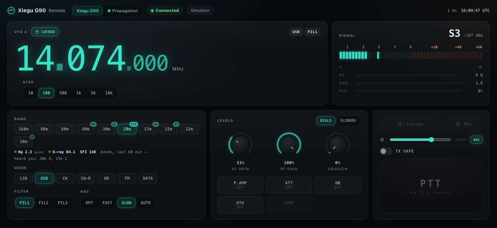
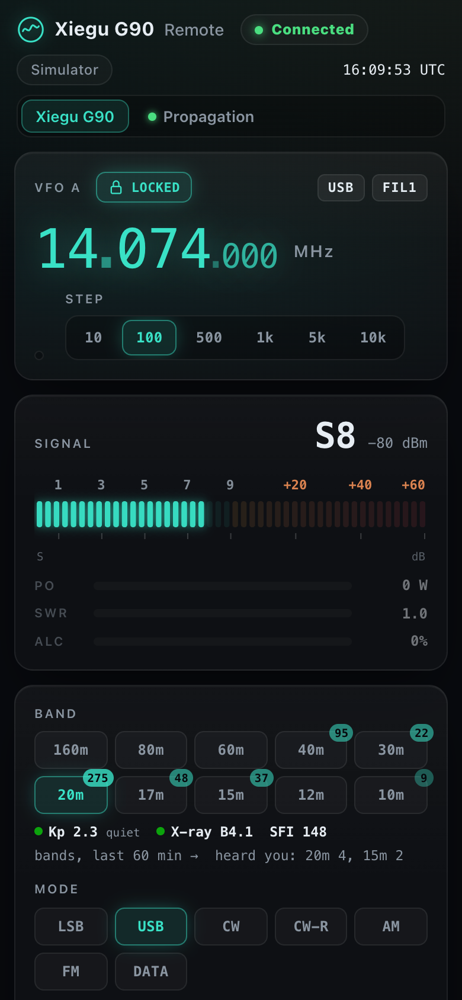
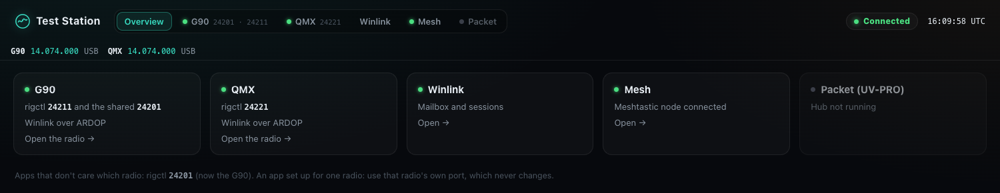
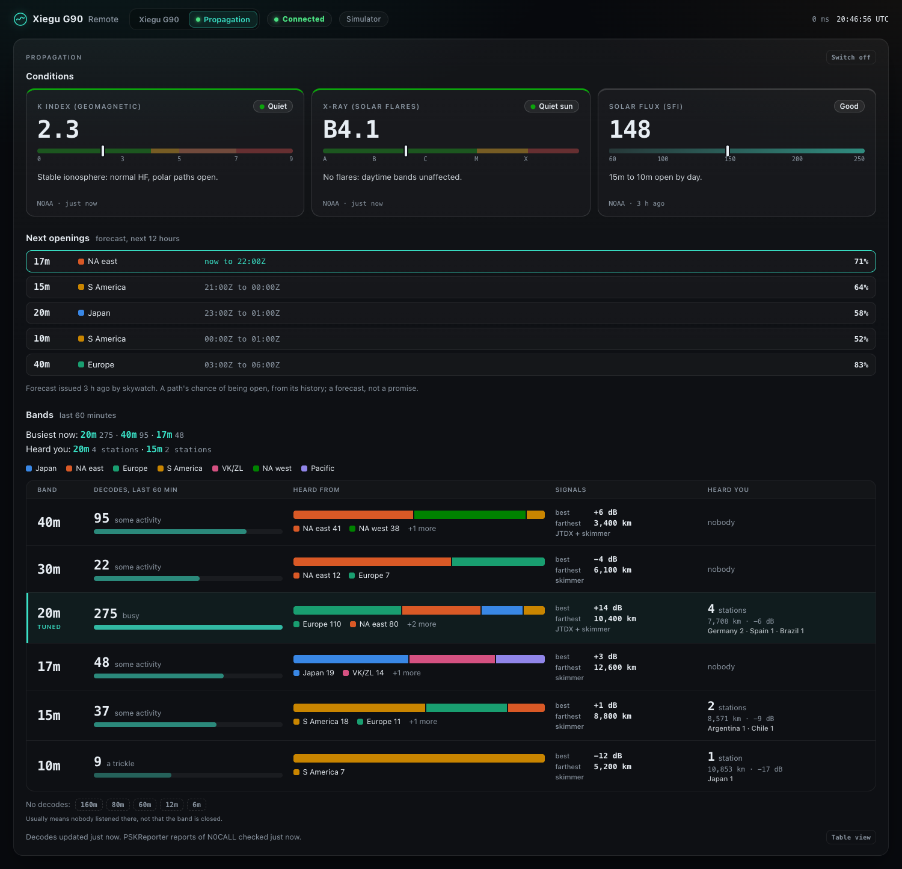

# Ranch Radio

A browser control panel for amateur radio transceivers on your local network.
Plug a radio into a Mac or a Linux machine, and any phone, tablet or laptop on
the LAN can tune it, see its spectrum, hear it and talk through it. A Linux
machine with several radios puts them all on one station page. Add-on modules
bring in Winlink, Meshtastic, APRS packet and handheld-radio control.



```
radio ──USB──> host (Ranch Radio) ──LAN──> browser(s)
       CAT serial + USB audio
```

## What you get

- **The radio on a page.** A big tunable frequency display, the radio's own
  spectrum and waterfall (where it has one), S-meter and transmit meters,
  band, mode and filter, AF/RF/squelch/power, DSP toggles and the tuner.
- **Audio both ways.** Receive audio in the browser, and push-to-talk with the
  device's microphone, with a per-band transmit level.
- **Apps keep working.** Each radio answers Hamlib's rigctl protocol on its
  own port, so WSJT-X, JTDX and other apps share the radio with the page.
- **Propagation at a glance.** Under the band buttons: the K index, X-ray
  flare class and solar flux, and a badge on each band with the decodes heard
  in the last hour. A Propagation tab explains them (below).
- **Packet.** APRS and Winlink packet through Direwolf, a network KISS TNC or
  a UV-PRO over Bluetooth, with transmit off until you allow it. APRS
  messaging with acks and retries, a probe that proves a reply can reach
  the radio, and a watch on the local iGates that carry internet traffic
  onto the air.
- **One page for the station.** Every radio, Winlink, Mesh, the packet hub
  and the add-ons behind one address, on a Mac or on Linux. A station of one
  radio opens on that radio. On Linux a shared rigctl port follows the radio
  connected longest, as well as each radio's own.
- **Updates that don't interrupt you.** A radio that is transmitting, in a
  Winlink session or driven by JTDX or WSJT-X is left alone until it's free.
- **Modules** you switch on per machine, from a **Modules** tab on the page or
  the command line (below).

<p align="center"></p>



## Supported radios

| Rig | Radio | Link | Status |
|---|---|---|---|
| `ic7300` | ICOM IC-7300 | CI-V over USB | **Tested** |
| `g90` | Xiegu G90 | CI-V (via a Digirig or similar) | **Tested** |
| `qmx` | QRP Labs QMX / QMX+ | Kenwood-style CAT over USB | **Tested** |
| `ic705` | ICOM IC-705 | CI-V over USB | Built from the CI-V reference |
| `ic7610` | ICOM IC-7610 | CI-V over USB | Built from the CI-V reference |
| `ic9700` | ICOM IC-9700 | CI-V over USB | Built from the CI-V reference |
| `ic7100` | ICOM IC-7100 | CI-V over USB | Built from the CI-V reference |
| `x6100` | Xiegu X6100 | CI-V | Built from the CI-V reference |
| `hamlib` | anything `rigctl -l` lists | via rigctld | Generic |

"Tested" means run against the real radio. The page shows only the controls
a radio has.

## Install (macOS or Linux)

You need Python 3.12 or newer and git. Plug the radio in first.

```sh
git clone https://github.com/cvp1/ranch-radio.git ~/ranch-radio
cd ~/ranch-radio && ./install.sh --call YOURCALL
```

`install.sh` is safe to run again. It:

1. Makes a Python venv (`.venv`) and puts `ranch-radio` on your PATH
   (`~/.local/bin`).
2. Runs `ranch-radio init`, which finds the radio's serial port, guesses the
   rig from its USB names, pairs its sound card on Linux, and writes this
   machine's host file to `~/.config/ranch-radio/hosts/<host>.json`. If it
   can't tell, it lists what it found: pass `--rig` and `--port`.
3. Runs `ranch-radio doctor --fix`, which installs what needs no root.
4. Installs and starts the services: a launchd agent on macOS, systemd user
   units on Linux.
5. Runs `ranch-radio doctor`, which lists anything left with its fix. Steps
   that need root, like joining the serial port's group, are printed for you.

Then open `https://<this-machine>:7300/`. The certificate is self-signed; on a
Mac, `macos/install-webapp.sh` trusts it and installs the page as an app.

**Without `--call` the radio is receive-only.** To allow transmit later:
`ranch-radio init --force --call YOURCALL`, then `ranch-radio update --apply`.

## Everyday commands

```sh
ranch-radio doctor            # what this machine's modules need, and whether it has it
ranch-radio update --check    # is there an update? (exit 2 when there is)
ranch-radio update            # what an update would pull and change (pulls nothing)
ranch-radio update --apply    # pull, install, restart what changed (never a radio in use)
ranch-radio update --apply --drop-rigctl   # restart a radio JTDX/WSJT-X is connected to anyway
ranch-radio add mesh          # switch a module on (dry run; --apply writes the host file)
ranch-radio remove mesh       # switch it off
ranch-radio modules           # every module and what it needs
ranch-radio where             # the host file this machine uses
ranch-radio install           # what the host file would install (--apply writes it)
ranch-radio start             # enable and start everything installed
ranch-radio drift             # installed files vs. the host file (--diff for details)
ranch-radio radios            # this station's radios, one line each
```

## Updates

`ranch-radio update --apply` is the one update command, and it is safe to run
any time:

- **Packages first.** It checks that the host's Python has what
  `requirements.txt` asks for, and installs it into the checkout's `.venv`. If
  the host runs another Python (a system one), it stops and says what to
  install, and the code goes back where it was. Nothing restarts.
- **Radios in use are left alone.** A radio that is transmitting, in a
  Winlink session, or has an app such as JTDX or WSJT-X connected to its
  rigctl port keeps running, and the update says which and why. A restart
  would drop the app's rig control, and JTDX then waits on an error dialog
  instead of reconnecting. The radio is restarted on the new code at the next
  update, and `--check` reports it until then. `--drop-rigctl` restarts a
  radio that only has a rigctl client, never one that is transmitting or in a
  Winlink session. A radio you switched off stays off.
- **Checked, and rolled back.** After restarting, every server that was serving
  must serve again within a minute. If one doesn't, the code goes back to the
  commit it came from, every file the update replaced is put back exactly as
  it was (files it added are moved aside and their agents stopped), the old
  code is restarted on them, and the update confirms those servers serve
  again. A rollback never re-renders: a host file edited for the new code
  isn't read by the old one. The same happens if the new code crashes before
  it can check itself. That commit is not tried again until a newer one lands
  (`--force` tries it anyway).
- **It knows what the servers run.** If the checkout moves without an update,
  for example by a hand `git pull`, `--check` says so. The next
  `update --apply` restarts the servers on it, with the same checks.

**The daily check.** Every host runs `ranch-radio update --scheduled` at 10:00:
a launchd agent on macOS, a systemd timer on Linux. It shows a desktop
notification once per new commit. To have it apply updates itself, with the
same checks and rollback, or to change the time, add to the host file:

```json
"updates": {"apply": true, "at": "10:00"}
```

`"updates": false` turns the daily check off. An installed job then does
nothing; to remove it, run `launchctl bootout gui/$(id -u)/org.ranch-radio.update`
on a Mac or `systemctl --user disable --now ranch-radio-update.timer` on Linux.
When nothing new has landed, the job leaves host-file edits for you to install
with `update --apply`. A code update installs everything the host file
renders. The job skips a run when no server is serving, because it would
have nothing to check the new code against. On a Mac its log
is `~/Library/Logs/ranch-radio-update.log`; on Linux,
`journalctl --user -u ranch-radio-update`.

## Modules

| Module | What it adds | Needs |
|---|---|---|
| `winlink` | Winlink email over HF (ARDOP), from the page | Pat; ardopcf (built from `ardop/`) |
| `vara` | Winlink over VARA HF beside ARDOP, picked per session (macOS; xara, unregistered) | `winlink`; xara (built with cargo, below) |
| `mesh` | A Meshtastic node on the page: channels, DMs, nodes, map | a node over USB or Bluetooth; the `meshtastic` package |
| `packet` | An APRS and Winlink packet hub on Direwolf (a USB sound card cable such as an AIOC), a network KISS TNC, or a UV-PRO / UV-50PRO over Bluetooth (BlueZ on Linux, IOBluetooth on macOS); optional receive-only iGate | Direwolf, a network TNC, or Bluetooth |
| `uvpro` | UV-PRO / UV-50PRO control: channels, settings, beacon | `benlink`; the packet hub on the same radio |
| `opengd77` | A TYT MD-UV390 on OpenGD77 firmware: front panel, channels, codeplug editor | `dmrconf` (qdmr) |
| `propagation` | Space weather (K index, X-ray, solar flux) under the band buttons; per-band decodes heard, who heard you and the next forecast openings, as badges and a Propagation tab | Internet for NOAA; optional skywatch InfluxDB and PSKReporter callsign |
| `logbook` | Your web logbook (Wavelog, Cloudlog) in a Logbook tab beside Propagation | a logbook with a web page |
| `macos-widget` | A menu-bar on/off switch for the radio server | Xcode command-line tools |
| `omarchy-bar` | Bar toggle, tune button and JTDX launcher on Omarchy Linux | Omarchy |
| `remote-audio` | JTDX on another machine, with the radio's audio over SSH or WebSocket (Linux, set up by hand) | PipeWire |

Three more modules are services a host gets from its host file rather than
switches: `station` (every radio on one page, Linux), `audio` (pinned
PipeWire sound card names, Linux) and `updates` (the daily check, below).

Add one with `ranch-radio add <module>` or from the page's **Modules** tab;
either shows the change to the host file first. Then run
`ranch-radio doctor --fix` and `ranch-radio update --apply`. Each add-on also
has an on/off switch on the page.

The `propagation` add-on reads NOAA's public space weather feeds with no
setup. Two optional sources fill in the bands:

```json
"addons": {"propagation": {"enabled": true,
                           "skywatch": {"url": "http://192.168.1.20:8086", "db": "skywatch"},
                           "pskreporter": {"call": "N0CALL"},
                           "window_min": 60, "forecast_h": 12}}
```

When the skywatch database also has its propagation forecast
(`skywatch_forecast_window`), the tab lists the next openings: each band and
region forecast open in the next `forecast_h` hours, soonest first, with its
best chance. Only the newest forecast counts, so an opening a later forecast
withdrew never shows. Without that measurement the section doesn't appear.

A band with no decodes reads "no data", never closed: a receiver hears only
the band it's tuned to. A source that can't be reached reads "unknown", never
zero. PSKReporter is asked at most every 10 minutes.



**The Logbook tab.** The `logbook` add-on shows your web logbook (Wavelog,
Cloudlog) in a tab beside Propagation, with a link to open it in its own tab.
The browser loads the logbook directly, with its own login, and only when the
tab is first opened; the radio's server never talks to it. Give its address,
or just its port when it runs on the radio's own machine:

```json
"addons": {"logbook": {"enabled": true, "url": "https://192.168.1.20:8087/"}}
"addons": {"logbook": {"enabled": true, "port": 8087}}
```

With `port` (and optional `"scheme"`, default https, and `"path"`) the frame
uses the same machine name as the page, so the browser counts it as the same
site and the logbook's login cookie holds inside the frame. A secure (https)
radio page can't frame a plain-http logbook: the tab then offers only the
link, so give the logbook an https front door. If the frame is blank, open
the logbook once in its own tab and accept its certificate.

**The Winlink mailbox.** Open a message to read it (that marks it read in
Pat), then Reply, Reply all, Forward (its attachments go along), Archive or
Delete (a second click confirms) from the read pane; while a session runs the
outbox is Pat's, and the page and the server both refuse to change it.

**Winlink packet through a UV-PRO.** With the `uvpro` add-on on and reaching
the radio through the packet hub's control port (`"control"`), a packet
gateway picked in the Winlink panel is tuned for you: after you confirm
Connect, the add-on selects a channel already on the gateway's frequency (FM
simplex) and turns dual watch off, and after the session it puts the radio
back on the channel it was on, so APRS and the iGate carry on. A radio with a
VFO uses VFO A when no channel has the frequency. A UV-50PRO has no VFO over
Bluetooth, so for other gateways name a spare channel the add-on may write
(its old contents go back afterwards):

```json
"addons": {"uvpro": {"enabled": true, "address": "00:11:22:33:44:55", "calls": ["N9ABC"],
                     "hub": "http://127.0.0.1:7310", "control": "tcp:127.0.0.1:8002",
                     "qsy_channel": 30}}
```

Without a channel to use, the connect is refused, saying why, rather than
dialing on whatever channel the radio is on. With the add-on off, or
borrowing the radio instead of using `"control"`, nothing is tuned: the
panel tells you which frequency the radio must already be on.

**Winlink peer-to-peer (P2P).** Mail between two stations with no gateway
and no internet. Switch the session panel from Gateway to Peer, pick the via
and type the other station's callsign: the frequency (kHz) for a radio via,
or its host:port and telnet password for telnet. Pat sends a peer only the
messages addressed to that station alone (or to an auxiliary address it
advertises); the session ends with "N sent, M left in the outbox", which is
not a warning. Tick **P2P only** in Compose for a message that must never go
via the Winlink servers: a gateway session leaves it in the outbox ("1 left
(P2P only)"), and its rows show a P2P badge. Packet URLs stay inside the
VHF/UHF data sub-bands (47 CFR 97.305(c): 2 m from 144.1 MHz) and never on
the APRS channel, 144.390 MHz. Another station calling yours is shown as
"Answering CALL"; the outbox is Pat's until it ends, and it is capped like
your own sessions.

**P2P directory.** In Peer mode the panel lists stations that asked to be
listed for P2P Winlink (a public directory; spec and "get listed" at
[cvp1.github.io/p2p-directory](https://cvp1.github.io/p2p-directory/)). Rows
this station can call come first, nearest first when Pat's config has a
`locator`; the rest are dimmed with the reason. A click fills the callsign,
the **dial** frequency (the directory publishes centre; VARA HF, ARDOP and
PACTOR dial 1.5 kHz below) and the via. It never connects: you still press
Connect and confirm. The station fetches the file at most every 6 hours and
keeps the last good copy, shown with its age when the directory can't be
reached. Turn it off with `"directory": false` in the host file's `winlink`
block, or point it elsewhere with `{"url": "https://…", "refresh_hours": 6}`.

**Listening for calls (a listen window).** So that others can leave mail
at your station when the internet or the gateways are down, the Winlink
panel can answer stations that call yours, on one VHF/UHF packet
frequency, for a bounded time. It is offered only when the host file names
the frequency, a programmed FM simplex channel on the hub's radio inside
the 2 m (from 144.1 MHz), 1.25 m or 70 cm data sub-band, never 144.390:

```json
"winlink": {"pat": "pat", "listen": {"ax25+agwpe": {"mhz": 145.090, "max_hours": 4}}}
```

**Listen** (two clicks) tunes the radio there, relaunches Pat listening on
the packet hub and opens the hub's inbound window; APRS and the iGate are
off-frequency until it ends. **Stop listening**, the window's end (at most
`max_hours`, 0.25 to 12), the hub or an add-on going away, or the server
stopping close it in a fixed order: the hub's window, any session still up,
Pat, and only then the radio. Unattended VHF data under automatic control
is allowed in these sub-bands (47 CFR 97.221(b)), so closing the page does
not end it; the hub ends its own window at the same time whatever happens to
the server, and a server that crashed undoes the window when it starts
again. HF listening is not offered.

**Winlink over VARA HF (xara), on a Mac.** VARA HF is the HF mode most
Winlink gateways run; the `vara` module adds it beside ARDOP, picked per
session. The modem is [xara](https://github.com/x0rro/xara), an open VARA HF
modem, in its default (unregistered) build: its speed is capped at level 4,
so on a good path it can be slower than ARDOP 2000. That is expected and is
not by itself a reason to buy a licence. xara keys the radio itself, through
its own Winlink lane on the radio's server (port 4534 by default), and only
while a VARA session is armed from the page; during an ARDOP session the
VARA lane can't key, and the ARDOP lane can't during a VARA one. xara sends
its own CW ID at the end of every session for a US call; the page shows it
as "ID sent" (by xara) only when the lane saw that key end normally.

1. Build xara (no macOS release binary; the Rust toolchain is about 1 GB):
   `brew install rust && cargo install --locked --git https://github.com/x0rro/xara --tag v0.1.3 --root ~/.local xara`.
   `xara --list-devices` names the radio's sound card ("USB Audio CODEC").
2. In Pat's config (ranch-radio never writes it), by hand:
   `"varahf": {"addr": "localhost:8300", "rig": "ic7300", "ptt_ctrl": false, ...}`,
   where `hamlib_rigs.ic7300.address` is this radio's Winlink lane
   (`localhost:<lane>`): Pat moves the dial through it, and never keys for
   VARA. The server refuses a VARA session, naming the field, until all
   three are so; `ranch-radio doctor` says the same.
3. `ranch-radio add vara --set audio_in="USB Audio CODEC" --set audio_out="USB Audio CODEC" --set call=N0CALL`,
   then `ranch-radio doctor` and `ranch-radio update --apply`. macOS asks
   for the microphone once for xara (and again after each reinstall):
   allow it.
4. Set the transmit level with `drive_db` (xara's own, 0 or below), not the
   codec table: the codec table is ARDOP's.

Every session, ARDOP or VARA, leaves one `winlink session: {...}` line in the
server log (scheme, bandwidth, gateway, frequency, seconds, outcome, messages
and bytes, and xara's highest speed level). After a week of the trial, keep
VARA if it connects where ARDOP does not, or fails less often to the same
gateways; consider the licence only if sessions sit at level 4 with a good
signal; otherwise drop it.

A VARA connect while nothing is armed (Pat dialing on its own) is refused at
xara's first key; xara exits on a refused key, and launchd starts it again
after 10 s. Until Pat stops, that repeats; the server logs the refusal once
per 10 s.

**Drop VARA.** Install does not stop what it no longer renders, so:
`ranch-radio remove vara --apply`, then `ranch-radio update --apply`; then
`launchctl bootout gui/$(id -u)/ranch-radio.xara` and
`mv ~/Library/LaunchAgents/ranch-radio.xara.plist ~/.Trash/`. Check that no
`xara` process runs (`pgrep -x xara`), nothing listens on 8300, 8301 or the
VARA lane port (`lsof -nP -iTCP -sTCP:LISTEN`), and the Winlink panel's
modems are ARDOP only. With VARA off the server does not open the VARA lane,
so a xara left running can't key; `ranch-radio doctor` warns while one is
still there.

## Safety

- **Receive-only until you give a callsign** (`init --call`).
- **Transmit limits.** Every transmission has a time limit (60 s in the host
  file `init` writes), and the radio unkeys if the operator's browser goes
  quiet.
- **Winlink.** The modem's rigctl lane keys only during an armed session, and
  sessions end with a station ID. A packet session through a UV-PRO is tuned
  only after you confirm Connect, never while a packet link is up, and is
  refused rather than sent out on the wrong channel. Pat is not started at
  all while its config would make it listen, beacon or run scheduled
  connects on its own (`listen`, `schedule`, `ax25.beacon.every`); the panel
  and `doctor` say what to clear. The packet hub answers another station's
  connect only inside an inbound window a listen window opens, so Pat's
  registration alone never makes the radio answer; a listen window is VHF/UHF
  packet only, in a data sub-band, bounded in time, and undone even after a
  crash.
- **STOP TX.** An always-visible switch on the radio page ends the radio's
  transmission and any tune, aborts Winlink, and latches until a page
  presses Resume (it doesn't survive a server restart). The packet hub has
  its own **Off**, which does survive a restart: it is written to disk before
  the page is told it worked, and an unreadable state file starts the hub
  with transmit off.
- **Off-channel holds.** Before Winlink retunes a UV-PRO the packet hub is
  asked to hold APRS, and the retune is refused if it can't; the hold is
  released only after the radio is verified back on its channel, survives a
  hub restart, and can be released from the packet page.
- **LAN only.** The servers refuse requests from web pages on other sites
  (Host and Origin checks), so a page from the internet, open in a browser on
  your LAN, can't reach the radio. There is no login: run it on a network you
  trust, or start the server with `--token`.

You are responsible for operating within your license.

### Linux Sound Card Node Stability & WirePlumber

On Linux, Ranch Radio pairs USB audio sound cards via PipeWire. Replugging a device
or system reboot can cause dynamic ALSA enumeration shifts. Ranch Radio's installer
renders WirePlumber rules (`~/.config/wireplumber/wireplumber.conf.d/51-ranch-radio-audio.conf`)
from each radio's configured `audio_in` and `audio_out` node names, matching nodes
and enforcing persistent node naming and session priority.

Verify active sound card node names at any time with:
```sh
wpctl status
# or
pw-cli list-objects Node | grep -E 'node.name =|media.class ='
```

### Network KISS TNC & Packet Hub

For packet radio (APRS & Winlink), Ranch Radio's packet hub can use a network
KISS TNC such as [Direwolf](https://github.com/wb2osz/direwolf) as well as a
Bluetooth TNC. Direwolf owns the sound card and modem; the hub connects to its
KISS-over-TCP port and adds the APRS store, the web page, transmit safety, and
AGWPE and KISS ports for Pat and other clients. A host with no radios of its own
can run it.

**1. Direwolf.** Enable its KISS port in `direwolf.conf`:

```
MYCALL N9ABC-10
MODEM 1200
KISSPORT 8001
```

[`examples/direwolf/direwolf.conf`](examples/direwolf/direwolf.conf) is a complete
example with every transmitting line (beacon, digipeater, iGate) commented out.

**2. Host file.** Point the `"packet"` block at it with `tcp:<host>:<port>`:

```json
"packet": {"url": "http://127.0.0.1:7310", "agwpe": "127.0.0.1:8000",
           "tnc": "tcp:direwolf.local:8001", "mycall": "N9ABC",
           "allow_calls": ["N9ABC"], "tx": false}
```

[`examples/hosts/linux-direwolf.json`](examples/hosts/linux-direwolf.json) is a
whole host file. Then `ranch-radio install --apply` renders a dedicated
`packet-hub.service` systemd unit, with no Bluetooth, BlueZ or UV-PRO
dependency. The station dashboard shows the hub under its configured name (for
example `Packet (Direwolf)`).

**3. Check it.** The hub page is at `http://127.0.0.1:7310/`, and
`curl http://127.0.0.1:7310/api/status` shows `"radio": {"up": true}` once it
has connected. Received frames appear in the heard list and the APRS store.

- **Receive-only until you say so.** `"tx": false` (or leaving it out) never
  transmits. Set `"tx": true` to allow it. Every frame must come from one of
  `allow_calls` (any SSID); anything else is refused and logged.
- **No authentication.** Direwolf's KISS and AGWPE ports have none, and anyone who
  can reach the KISS port can transmit through your radio. Firewall it to the
  machine that runs Ranch Radio. The hub's own AGWPE and KISS ports bind to
  `127.0.0.1` by default.
- **Same machine?** The hub listens on `127.0.0.1:8000` (AGWPE) and `:8001` (KISS).
  If Direwolf runs on the same machine, give Direwolf other ports (for example
  `KISSPORT 8011`) and use that port in `"tnc"`.
- **If Direwolf goes away,** the hub keeps running and reconnects by itself,
  retrying after 2, 4, 8, 16, then every 30 seconds.
- **iGate, receive only, for any TNC:** add
  `"igate": {"login": "N9ABC-10", "passcode": "~/.config/ranch-radio/aprs-is-passcode"}`
  to the `"packet"` block (`"server"` is optional, default `noam.aprs2.net`).
  The hub itself sends what it hears to APRS-IS, so this works with a UV-PRO
  over Bluetooth or a serial or network TNC, not only with Direwolf. It skips
  packets with TCPIP, TCPXX, NOGATE or RFONLY in the path and queries, sends
  each packet once however many digipeaters repeat it, marks each line
  `qAO` (a receive-only iGate, per aprs-is.net), never gates our own calls'
  frames (outer or inner), and never sends anything from APRS-IS on the
  air. `"observe": true` (the default when messaging is on) also reads
  APRS-IS for our own calls (`filter b/<call>* g/<call>*`); what comes back
  is stored as `is` and shown "via internet", and is never acked or sent.
  `api/status` shows it under `"igate"`. A
  host runs one iGate: the hub's, or Direwolf's (below), not both.
  `"beacon_min": 30` (10 to 120) adds the iGate's own position beacon, to
  APRS-IS only, never RF, with the receive-only iGate symbol `R&`; it needs
  `"position"` in the `"packet"` block. `"comment"` sets its text.
- **Fill-in digipeater, for any TNC but Direwolf:** add
  `"digi": {"call": "N9ABC-1"}` to the `"packet"` block (with `"tx": true`).
  It repeats only WIDE1-1 as the first hop (`WIDE1-1,WIDE2-1` becomes
  `N9ABC-1*,WIDE2-1`) and packets addressed to its call; never WIDE2-n or the
  old RELAY/WIDE/TRACE. It is *viscous*: a WIDE1-1 packet waits
  `"viscous_s"` (default 5) seconds, and if a wide digipeater repeats it in
  that time, it isn't sent, so a site inside wide coverage only fills the
  gaps. Each packet goes at most once per 30 s, through the transmit gate with
  its own `"max_per_min"` (default 6). `api/status` shows it under `"digi"`.
  With Direwolf as the modem, use Direwolf's own `DIGIPEAT` instead.
- **APRS messaging:** add `"aprs": {"messaging": "send"}` to the `"packet"`
  block (with `"tx": true`). The packet page's Messages tab gets threads and
  a compose box, enabled once **TX ARMED** is switched on in that browser.
  Messages go with a message number and retries at 0, 30, 90, 210, 450 and
  930 s, one per slot (a slot missed during a pause is skipped, never caught
  up), until acked or 1,410 s pass. `send` acks nothing it hears and puts no
  reply-ack on its messages; `"messaging": "full"` also acks messages to
  `"owned_calls"` (default: `mycall`) heard live on RF, and needs
  `"firmware_acks": false`, set only once you know the radio's own firmware
  doesn't ack them too (send it a numbered message in `send` mode and watch
  its transmit light). Messages and acks pause while a KISS client, a
  monitoring AGWPE client, a Winlink link, a listen window or an off-channel
  hold is in the way, and the page says why. Acks have their own share of
  the transmit gate's count and airtime, so app traffic can't starve them.
  Each conversation can be managed from the page: **Cancel** a message still
  retrying, **Resend** one that failed, **Delete** a message or the whole
  conversation, **Archive** it until a new message arrives, mark it read or
  unread, and **Export** it as text. Read marks live in the hub, so every
  browser shows the same unread badge. Heard messages between other stations
  are kept 30 days; yours stay until you delete them.
- **The round-trip probe:** `"aprs": {"probe": {"target": "WXBOT", "text":
  "CWOP"}}` puts a **Probe** button on the Messages tab. One press sends one
  message and reports five legs separately: sent, digipeated copy heard,
  reached APRS-IS through someone else's iGate, the target's ack back over
  RF, and acked, each with its evidence. A leg the hub couldn't observe (the
  radio off its channel, the observer down) reads *unknown*, never a pass.
  One probe at a time, and not again until the last one's deadline passes.
- **The iGate watch** (on unless `--igate-watch-min 0`): a receive-only
  station gets internet messages only through other stations' transmitting
  iGates. Each finished day is judged from every RF copy each iGate sent
  onto the air: fewer than two iGates with 3 packets each is *low*, a day
  with under 200 frames heard is *unknown*. A desktop notification goes out
  only on a drop and on the recovery; `api/status` shows the last day under
  `"aprs" "igate_watch"`.

### Direwolf on a USB sound card cable (AIOC), and an iGate

A VHF/UHF radio with no built-in TNC can do packet through a sound card
cable, such as an [AIOC](https://github.com/skuep/AIOC), a Digirig, or a CM108
dongle, with Direwolf as the modem. Ranch Radio runs both Direwolf and the
packet hub, on macOS or Linux:

```json
"packet": {"url": "http://127.0.0.1:7310", "agwpe": "127.0.0.1:8000",
           "tnc": "direwolf", "mycall": "N9ABC", "allow_calls": ["N9ABC"], "tx": false,
           "direwolf": {"usb": "1209:7388", "audio": "AIOC Audio", "ptt": "off"}}
```

- **`usb`** is the cable's USB ID, VID:PID; an AIOC is `1209:7388`.
  Direwolf waits until the cable is plugged in. If the cable drops off USB,
  Direwolf restarts and waits for it again, because it can't recover a sound
  card that went away.
- **`audio`** is the cable's sound card as Direwolf names it. An AIOC is
  `AIOC Audio` on a Mac. Direwolf's log lists every name it sees.
- **Direwolf has no network ports.** The hub talks to it through a
  pseudo-terminal (`/tmp/kisstnc`). Direwolf's KISS and AGWPE ports would
  listen on every interface with no authentication, which would let anyone
  transmit past the hub's transmit gate.
- **Transmit needs both switches.** `"ptt": "serial"` lets Direwolf key the
  radio through the cable's serial port: DTR on, RTS off, which is the AIOC's
  default. `"tx": true` lets the hub send. Both are off by default.
- **`txdelay`** (ms) is how long Direwolf keys the radio before the data. The
  default is 300. A radio that's slow to start transmitting needs more: a
  BTECH UV-50X2 on an AIOC needed 600 before a digipeater would decode it.
- **iGate, receive only:** add
  `"igate": {"login": "N9ABC-10", "passcode": "~/.config/ranch-radio/aprs-is-passcode"}`
  to the `direwolf` block, and put your APRS-IS passcode in that file.
  Received packets go to APRS-IS. Nothing from APRS-IS is ever sent on the
  air.
- **On a Mac, allow the microphone.** macOS asks whether the service may use
  the microphone the first time Direwolf opens the cable's sound card. Answer
  Allow, or Direwolf hears silence.

[`examples/hosts/mac-aioc.json`](examples/hosts/mac-aioc.json) is a whole
host file. `ranch-radio doctor` checks that Direwolf is installed.

## How it fits together

- `server.py` runs one radio: its page, audio, rigctl port and Winlink lane,
  on loopback behind the station. It never runs Pat or decides a session.
- `station.py` is the page (7300) on every host: the radios, Winlink (Pat,
  arming a radio's lane over its WebSocket for each session), Mesh, the
  packet tab, the add-ons and the Modules tab, and on Linux a shared rigctl
  port.
- `ranch_radio/` is the shipping layer. Each machine's radios, services and
  modules are declared in one host file, and `ranch-radio install` renders the
  launchd agents or systemd units from it. `examples/hosts/` has a Mac with
  one radio, a Mac running Direwolf on an AIOC cable, a two-radio Linux
  station, a Linux laptop and a radio-less packet hub on a network Direwolf
  TNC.
- `addons/` holds the switchable modules; `static/` is the page (no build step).

## Development

```sh
.venv/bin/python tests/<name>_test.py     # one suite
bash tests/run_all.sh                      # everything (page tests need Chrome or Chromium)
```

Tests use simulated radios and stand-in service managers; none touches a real
radio.

The screenshots in this README come from a simulated radio with made-up data.
`python3 tools/readme_screenshots.py` takes them again into `docs/images/`.

## License

MIT. See [LICENSE](LICENSE).
